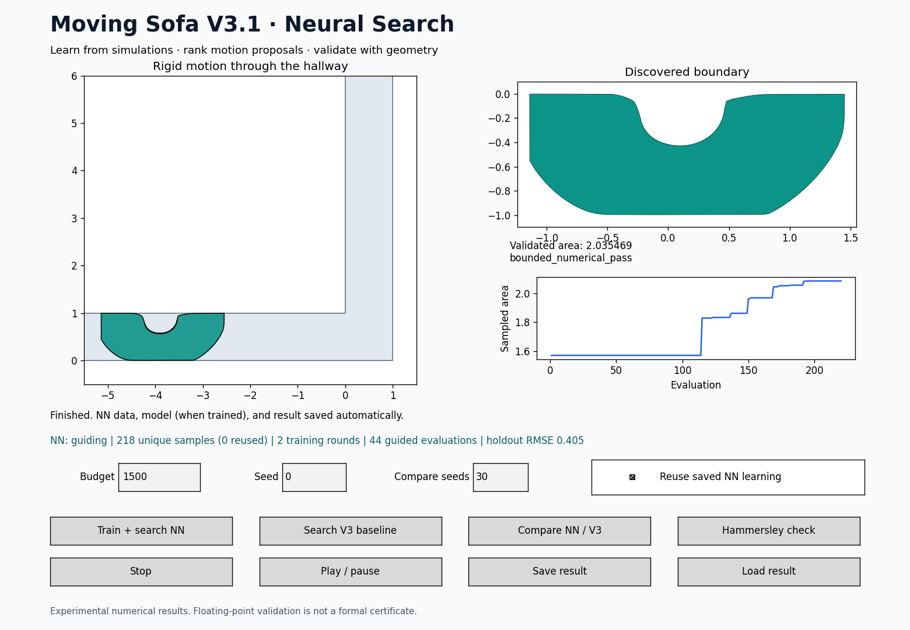

# V3.1 neural search

This is a direct V3 update. Extract the complete package into a new folder,
install `requirements.txt`, and open `run_v3.py`. No V2 files are needed. Keep
your own saved V3 results; they remain loadable. The previous V3 files and
measurements bundled in this archive are retained for comparison.

## First run from VS Code

1. Install dependencies once: `python -m pip install -r requirements.txt`.
2. Open `run_v3.py` and click **Run Python File**.
3. Leave Budget at 1500 for an initial run; Seed chooses reproducible randomness.
4. Click **Train + search NN**. Training and search happen automatically.
5. Watch the unique-sample count, training rounds, guided evaluations and
   holdout RMSE. Final validated area appears after reconstruction and checking.
6. Click **Play / pause** to inspect motion. NN results are saved automatically;
   **Save result** also makes a timestamped result in `results/`.



The NN is a CPU multilayer perceptron ensemble trained by backpropagation with
Adam through scikit-learn. It is a real trained neural model; PyTorch, CUDA,
API keys and internet access are not required to run it after installation.

## What the network learns

- Input: x, y and rotation at 17 evenly spaced times (51 inputs), evaluated from
  the complete turning spline. Adaptive knot insertion therefore keeps the
  feature dimension consistent.
- Architecture: three independently initialized 51 → 48 → 24 → 1 MLPs with tanh
  hidden units and linear scalar output. Each trains on a bootstrap sample.
- Target: the **sampled search area**, measured by real hallway intersections.
  This is a search objective, not the final validated area or a collision probability.
- All evaluations are journaled, including empty/zero-area and rejected
  candidates. Duplicate feature vectors are grouped and used once in training.
- First training starts after 64 unique samples (and sufficient holdout rows).
  Retraining happens after 64 additional unique samples during global search.
  After local/adaptive search, another eligible fit includes those observations.
- Scaling is fitted on training rows only. The latest 2,500 unique candidates
  are the fitting window; the complete on-disk journal is retained.
- About 20% of unique candidates form a stable hash-based holdout. It selects
  early-stopping weights and gates guidance. Guidance is enabled only if
  ensemble MSE beats the training-mean constant predictor's holdout MSE by 2%.
  This is a development diagnostic, not an independent test of optimization
  performance. Nearby candidates can be correlated.

When guidance is enabled, 30% of selection decisions keep an ordinary
differential-evolution candidate. Otherwise the NN ranks a pool of 16 motion
proposals. Within these guided decisions, 15% seek ensemble disagreement and
the remainder maximize predicted area plus a small disagreement bonus. Ensemble
spread is an exploration heuristic, not calibrated confidence. Every selected
candidate still receives a real geometry evaluation; no predicted area enters
the best-sofa archive. Powell refinement and contact-guided knot refinement
remain in the workflow and their measured observations feed subsequent training.

A budget below the warm-up requirement can finish without training. The GUI
reports zero training rounds and zero guided evaluations in that case. A
trained network may also keep the guidance gate closed when its predictions
are unreliable. The ordinary optimizer continues normally.

## Saved learning and continuation

The GUI and normal CLI use a geometry/schema-specific directory under
`results/nn_learning/`. Each directory contains:

| File | Contents |
|---|---|
| `schema.json` | Feature version, geometry source hashes and sampling settings |
| `evaluations.jsonl` | Every evaluated motion and measured sampled area, with run/seed IDs |
| `model.npz` | Three networks' numeric weights, scaling and training diagnostics; no pickle |
| `training.jsonl` | Training-round errors, epochs and timings |
| `validation_<run>.json` | Final geometry verification, separately from training labels |
| `result_<timestamp>.json` | Complete GUI search result, motion and polygon |

**Reuse saved NN learning** loads compatible data and weights for a new search.
It does not resume the exact interrupted optimizer population or RNG state.
Training metrics distinguish reused samples/models from new training. Uncheck
the box for a new independent learning folder. Stop preserves completed data
appends and the last completed model; an interrupted fit is not published.
An `active.lock` file prevents concurrent writers. After a hard process crash,
close any old process before removing a stale lock or choose a fresh directory.

The schema prevents silently mixing different geometry or sampling objectives.
Checkpoint arrays are loaded with `allow_pickle=False` and checked for valid
shapes and finite values. Training checks cancellation between epochs. A partial
last journal append is discarded on recovery; malformed interior records fail
with an error instead of being silently skipped.

## Fair comparison

**Compare NN / V3** ignores reusable interactive learning. Each NN seed starts
with no dataset and no model in an isolated fresh folder. Both methods use the
same seed, initial representation, candidate-evaluation budget, local/adaptive
settings, finalists and final validator. Order alternates across seeds. Both
methods spend real geometry evaluations for all accepted candidates. Training,
candidate feature extraction and NN inference are included in search runtime.

Equal evaluation budgets do not imply equal wall-clock cost. Compare final
validated area **and** total seconds. This experiment compares complete search
policies; it does not isolate learned ranking from the changed proposal pool
or exploration choices. A random-pool ablation would be needed for that claim.
The provided comparison uses a fixed evaluation budget, not a fixed-time budget.

Benchmark outputs include all run records, isolated learning journals/models,
`runs.csv`, `summary.json`, `comparison.png` and a source/environment manifest.
Completed runs resume only under matching configuration and source hashes.
Interrupted attempts restart cold in new learning folders. Use a new output
directory after changing settings or code. Historical result directories are
evidence, not folders to overwrite with new experiments.

```bash
python run_v3.py search --surrogate --budget 1500 --seed 42
python run_v3.py search --surrogate --budget 1500 --fresh-nn
python run_v3.py search --surrogate --nn-dir results/my_learning --budget 1500
python run_v3.py compare-nn --seeds 30 --budget 1500 --output results/new_nn_trial
python -m unittest discover -s tests -v
```

The regular `benchmark` command still supports the optional historical V1/V3
comparison; `compare-nn` never requires V2 or a V1 run. The geometric engine and
validation rules are unchanged. A numerical pass is still a floating-point
check, not a formal mathematical certificate. Neural search does not guarantee
Gerver reproduction or improvement over V3 on every seed or budget.

Training API reference: https://scikit-learn.org/stable/modules/generated/sklearn.neural_network.MLPRegressor.html
