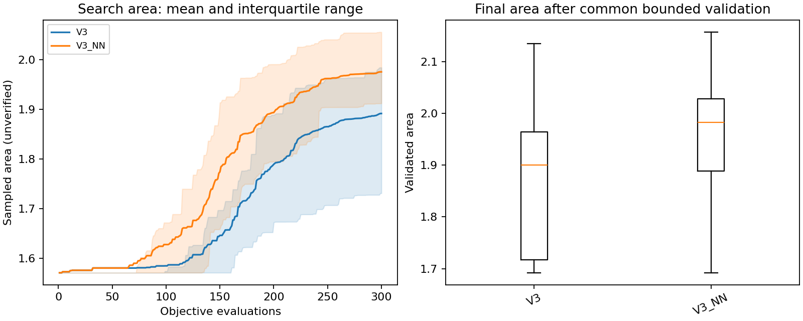

# V3.1 NN measurements — 25 October 2026

## Controlled small-budget comparison

30 paired seeds (0–29), 300 real geometry evaluations per method and seed.
Both use five initial spline controls, 49 search samples, local refinement,
adaptive knot insertion, one finalist and reconstruction target 0.003. NN runs
start without data or models. Both methods use the same final validator.

| Method | Mean validated area | Sample SD | Best validated area | Passed | Mean search / total seconds |
|---|---:|---:|---:|---:|---:|
| V3 | 1.872447 | 0.147359 | 2.134514 | 30/30 | 1.24 / 2.22 |
| V3 + NN | 1.950712 | 0.136807 | 2.156683 | 30/30 | 1.92 / 3.18 |

The mean area increase was **4.18%**.
NN won 18 seeds, tied 3, and lost 9.
The paired mean delta was 0.078265 square units, with a paired
bootstrap 95% interval [0.007049, 0.145916].
All 30 NN runs trained; 28 enabled guidance before their global-search budget
ended. In total 1,760 NN-ranked candidates received real geometry evaluations.
No rows or models were reused across seeds.

Mean total time increased **42.9%**, including training,
proposal features, inference, persistence and final validation. This is an
area improvement at a fixed evaluation budget, not a demonstrated speedup or
improvement at equal wall-clock time. Measurements use a shared Linux host;
some software checks ran concurrently, so timings are approximate.

The experiment compares the complete NN-guided proposal policy with V3. It
does not isolate the effect of learning from the new proposal pool/exploration
policy. Holdout training errors are development diagnostics and are not a
substitute for these independent optimization runs. No parameters were tuned
against the reported benchmark outcomes.



## Larger-budget pilot at the GUI defaults

Five paired seeds (0–4), 1,500 evaluations each, target 0.002, three finalists.
All other search settings are unchanged, and each NN run starts cold. This is
an exploratory pilot, not a 30-seed confirmation at the larger budget.

| Method | Mean validated area | Sample SD | Best validated area | Passed | Mean search / total seconds |
|---|---:|---:|---:|---:|---:|
| V3 | 2.205455 | 0.002039 | 2.207629 | 5/5 | 7.48 / 19.14 |
| V3 + NN | 2.195437 | 0.016095 | 2.205278 | 5/5 | 15.27 / 29.48 |

NN mean area was **0.45% lower**, winning 1/5 pairs.
Mean total runtime was **54.0% longer**. These results do not establish
that NN guidance improves larger-budget search. Keep ordinary V3 as the
benchmark; use NN mode to experiment with learning and measure its contribution.
Warm-start reuse is implemented and tested functionally but has not been shown
to improve optimization performance in a controlled benchmark.

No tuning was performed after observing these outcomes. The positive result at
300 evaluations should not be extrapolated to 1,500 evaluations, equal-time
budgets, or independent reproduction of Gerver.

## Software and geometry validation

- 23 unit/integration tests passed, covering the previous V3 checks plus neural
  learning, numeric model round trips, schema mismatch rejection, concurrent
  writer rejection, interrupted journal recovery, cancellable training, real
  geometry label checks, exact budgets, saved-model reuse, and cold benchmark isolation.
- The GUI was rendered and visually inspected. The actual worker callback,
  training, status updates, autosave, result display and playback were exercised
  with the Agg backend. Native Windows click-through was not tested here.
- All 70 benchmark results passed the inherited bounded numerical checker.
- The best NN result from the 300-evaluation study was separately audited at
  15,009 shifted-grid poses: zero collisions, both endpoints in separate arms.
- The previous geometry, motion and validator modules are unchanged. All 12
  historical attachment files in `legacy_v1/` remain byte-identical.
- These are floating-point numerical checks, not exact mathematical certificates.

## Raw evidence and reproduction

- `results/nn_comparison_30x300/`: 60 results, 30 fresh learning journals/models,
  source/environment manifest, CSV, aggregate summary and plot.
- `results/nn_comparison_5x1500/`: 10 results, five fresh learning journals/models,
  manifest, CSV, aggregate summary and plot.
- `results/nn_comparison_30x300/V3_NN_seed006_audit.json`: independent dense audit.
- `results/nn_software_validation.json`: software-check scope.
- `NN_GUIDE.md`: architecture, persistence, controls and methodological limits.
- `RESULTS.md`: unchanged historical V3 measurements; not V3.1 NN results.

```bash
python run_v3.py compare-nn --budget 300 --seeds 30 --target .003 --finalists 1 --output results/repeat_nn_300
python run_v3.py compare-nn --budget 1500 --seeds 5 --target .002 --finalists 3 --output results/repeat_nn_1500
python -m unittest discover -s tests -v
```
