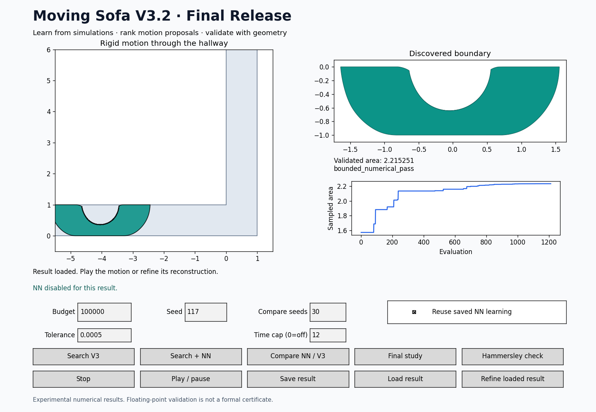

# Moving Sofa V3.2

A numerical optimization project that discovers a connected rigid shape and a
continuous motion through an L-shaped hallway. V3 is the default optimizer;
neural guidance is an optional experiment. Neither discovery mode starts from
Gerver's or Hammersley's known shape.



## Start here — Windows / VS Code

1. Use Python 3.10 or newer. Run `install_windows.bat` once, or run
   `python -m pip install -r requirements.txt`.
2. Double-click `launch_windows.bat`, or open `run_v3.py` in VS Code and click
   **Run Python File**. No terminal input is required after launch.
3. Click **Search V3**. The default is 1,500 evaluations, tolerance 0.002, no
   runtime cap. Both baseline and NN results now save automatically.
4. Use **Play / pause** to see the complete entry, turn and exit. Use **Load
   result** to open your old V3/V3.1 JSON files or the included examples.

If Python lacks a GUI backend, install Tk support for that Python installation.
`sofa_v3/` must remain beside `run_v3.py`. Run the launcher from this extracted
folder; V1 and V2 are not prerequisites. `legacy_v1/` is retained only for the
optional historical baseline comparison.

## What the final update changes

- **Diverse finalists:** keep a pool of up to `max(12, 4 × finalists)` motions.
  Nearby motions are merged using RMS pose distance on a common 33-point grid,
  so slightly different floating-point coordinates no longer consume every slot.
- **Progressive selection:** re-evaluate the pool on nested 97- and 193-point
  grids with the default 49-point search objective. Reduce the shortlist, then
  reconstruct and verify its finalists. Select the largest passing result.
  Search itself still optimizes sampled area; these refinements improve final
  selection and do not turn sampled area into a certificate.
- **Stricter neural gate:** require both lower held-out error than a constant
  predictor and at least 60% pairwise ordering accuracy among the strongest half
  of held-out candidates. These are operational gates, not independent tests.
- **Automatic fallback:** pause guidance for 64 proposals when its recent mean
  accepted improvement does not beat ordinary proposals. This comparison is a
  heuristic because the two streams visit different states.
- **Learned reconstruction loss:** store every passing finalist separately in
  `validated_training.json`. On a later compatible run, a small ridge model may
  correct the MLP's score using predicted reconstruction loss. It requires at
  least 32 distinct rows, sufficient holdout data and a held-out improvement
  over constant loss. Until then, it stays off. Predicted loss never establishes
  feasibility or replaces geometry validation.
- **Final-study workflow:** paired evaluation budgets, common total runtime
  caps, fixed-motion tolerance refinement and a separate shifted-grid audit.
- **Release usability:** automatic baseline saves, validated file loading,
  Windows launchers, visible tolerance/time controls and regression tests.

The default remains V3. Do not interpret the NN's presence as proof that it
improves area, speed or reliability. See `RELEASE_RESULTS.md` for measured results.

## Buttons and files

| Control | What it does |
|---|---|
| Search V3 | Ordinary optimizer with diverse, progressively refined finalists |
| Search + NN | Collect data, fit/gate proposal ranking, and validate with geometry |
| Compare NN / V3 | Paired fresh runs using the seed count, budget and optional time cap |
| Final study | Equal evaluations and equal time caps; refine/audit the best passing result |
| Refine loaded result | Rebuild the same motion at .004, .002, .001 and .0005; does not reoptimize the motion |
| Hammersley check | Analytic reference test, explicitly separate from discovery |
| Stop | Cooperatively interrupt search, training, reconstruction, study or audit |

Automatic single-run results are in `results/runs/` (baseline/reference) or
`results/nn_learning/<compatible-schema>/` (NN). The status line shows the path.
Comparisons/studies use timestamped `results/comparison_.../` folders.

Each experiment contains `manifest.json`, per-seed result JSON, `runs.csv`,
`summary.json` and `comparison.png`. A final study additionally contains:

- `equal_evaluations/` and `equal_time/`;
- `convergence.json` and `convergence_best.json`;
- `audit.json` and `final_summary.json`.

A compatible NN folder includes `evaluations.jsonl`, `training.jsonl`, numeric
`model.npz`, `schema.json`, `validated_training.json`, and validation records.
The source/tolerance schema chooses a new folder for this release. Old learning
is preserved but deliberately not mixed with changed code or tolerances.
Uncheck **Reuse saved NN learning** to start fresh. Only one writer may use a
learning folder. After a crash, close that process before removing its stale
`active.lock`, or use a new folder.

## Reproduce results

```bash
# One normal discovery run
python run_v3.py search --budget 1500 --seed 100

# Optional fresh neural experiment
python run_v3.py search --budget 1500 --seed 100 --surrogate --fresh-nn

# Paired equal-evaluation comparison
python run_v3.py compare-nn --budget 1500 --seed 100 --seeds 30 --output results/new_comparison

# Common total runtime cap, including training and final validation
python run_v3.py compare-nn --budget 100000 --seconds 30 --seed 100 --seeds 30 --output results/new_timed

# Complete study with GUI-equivalent controls
python run_v3.py final-study --budget 1500 --seed 100 --seeds 30 --seconds 30 --output results/new_study

# Rebuild a saved trajectory at successively tighter tolerances
python run_v3.py convergence --input results/my_result.json

# Additional independent sampled audit
python audit_export.py results/my_result.json --samples 5001

python -m unittest discover -s tests -v
```

The included `assets/demo.mp4` shows a saved discovered result moving through
the hallway. Regenerate it with `python render_demo.py result.json assets/demo.mp4`
(requires ffmpeg), or choose a `.gif` output.

The no-argument launcher opens the GUI. `--no-diversity` and
`--no-progressive` support selection ablations; existing `--no-local`,
`--no-adaptive` and `--fixed-angles` remain available. These ablations are not a
byte-for-byte V3.1 implementation; the original ZIP preserves that version.

## Fair comparisons and stopping

Equal-evaluation studies use the same number of candidate objective calls.
Promotion, training, adaptive probes, reconstruction and validation have real
costs; total runtimes are reported. Promotion counts are recorded separately.
Equal-evaluation counts alone do not establish equal computational cost.

Time-limited studies allocate 55% of the common wall-time cap to search (with
proportional global/local/adaptive phases), leaving the rest for selection and
validation. Only completed checks can supply a validated result. With short
caps, a run may end without one; failures remain in the success rate and in the
mean that counts failures as zero. A previously completed valid finalist may be
returned if later validation times out. There is no guarantee that all
finalists finish within the cap.

Caps are cooperative, not hard real-time guarantees: an indivisible numerical
operation, library import or output write can overrun. Numerical-work overrun
is reported explicitly; final file serialization is outside that clock. Use
the same idle machine, avoid other CPU-heavy jobs and inspect actual runtimes.
The search-curve plot shows the common evaluation prefix for variable-length
runs; it is not a validated-area-versus-time curve.

Fresh comparisons never reuse training across paired seeds. Warmed-up learned
reconstruction-loss correction is a separate mode and is not established by a
cold-start benchmark. Benchmark manifests include settings, source hashes and
dependency versions. Resume only with matching settings/source; choose a new
output directory after an update. Stopping retains completed run files.

## Numerical meaning and limitations

The optimizer uses differential evolution, Powell refinement and an adaptive
spline knot. Independent x, y and rotation splines allow nonsymmetric motions
and rotation reversal. Inverse hallway intersections retain concavities and
holes and select a connected polygon. No convex hull replaces the sofa.

**Search area is unverified. Use validated area for project metrics.** Conservative
reconstruction uses midpoint displacement bounds, then a forward checker uses
clearance bounds and a separate pose grid. `bounded_numerical_pass` means the
floating-point bounded checker passed; it is not an exact mathematical proof.
Adjacent exported motion segments must join continuously. Disconnected,
inconclusive, invalid, collided or unfinished candidate checks never supply a
validated area. The independent audit is an additional sampled implementation check.

The code uses finite controls, bounded translations, an eight-unit finite
hallway and a finite local shape window. It has no global convergence guarantee.
Tightening reconstruction tolerance on a fixed motion studies numerical area
loss; it does not establish optimizer convergence, a rigorous remaining-error
bound, or independent reproduction of Gerver's analytic construction. The
reference constants and attribution remain in `README_V3_1.md`.

A complete release means reproducible experiments, numerical checks, a usable
interface and documented limitations. Further pursuit of a larger validated
area is optional research. An inconclusive or negative NN comparison is a
valid experimental result.

## Project structure

| File | Role |
|---|---|
| `run_v3.py`, `sofa_v3/gui.py` | CLI and desktop controls |
| `sofa_v3/search.py` | Search, diverse archive, promotion and validated selection |
| `sofa_v3/neural.py`, `calibration.py` | Sampled-area MLP, gates/fallback, validated-loss model |
| `sofa_v3/motion.py`, `geometry.py`, `verify.py` | Spline motion, reconstruction and bounded numerical checking |
| `sofa_v3/experiments.py`, `study.py` | Paired experiments, convergence and release study |
| `audit_export.py` | Independent interpolation/transform sampled audit |
| `tests/` | Geometry, reproducibility, NN lifecycle and release regression checks |
| `legacy_v1/` | Unmodified historical files |

Historical `RESULTS.md`, `NN_RESULTS.md`, and `README_V3_1.md` describe earlier
versions. Use `RELEASE_RESULTS.md` for this release's measurements.
