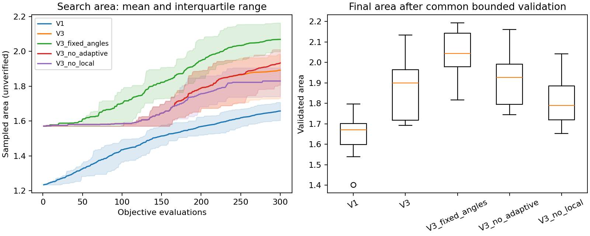
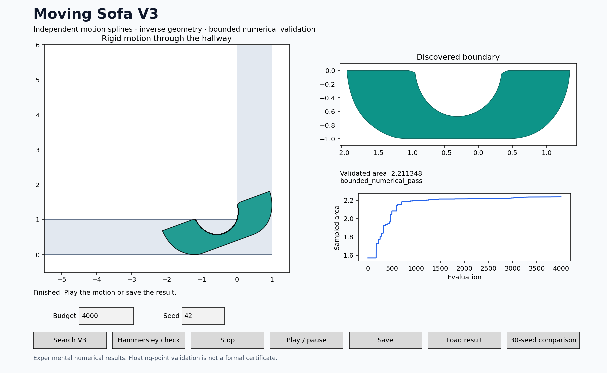

# V3 measured results — 25 October 2026

## Controlled comparison

30 paired seeds (0–29), 300 candidate objective evaluations per method per seed. One finalist per run, displacement target 0.003, common conservative reconstruction and bounded numerical verification. The V1 comparator is the attached Step 8 freeform search.

| Method | Mean validated area | Sample SD | Best area | Passed | Mean search / total seconds |
|---|---:|---:|---:|---:|---:|
| V1 | 1.65006 | 0.08060 | 1.79624 | 30/30 | 1.87 / 2.65 |
| V3 | 1.87245 | 0.14736 | 2.13451 | 30/30 | 1.22 / 2.24 |
| V3_no_local | 1.80654 | 0.09937 | 2.04226 | 30/30 | 1.06 / 2.01 |
| V3_no_adaptive | 1.91362 | 0.13371 | 2.16077 | 30/30 | 1.19 / 2.14 |
| V3_fixed_angles | 2.04849 | 0.10451 | 2.19352 | 30/30 | 1.31 / 2.44 |

Full V3 improved the mean over V1 by **13.48%**, winning **29 of 30** paired seeds. The paired mean difference was 0.22239 square units; its bootstrap 95% interval was [0.16864, 0.27891]. All 150 distinct method/seed runs passed the numerical checks. The V1/V3 records in the ablation directory are copies of the original paired records, not 60 additional independent runs.

**What the ablations actually show:** at this small budget, fixing angle(t) to a linear schedule gave the largest mean. Removing the adaptive knot also improved the mean. Removing local refinement reduced it. More degrees of freedom are therefore not automatically more effective at a fixed small budget. A plausible explanation is that fewer variables are easier to optimize, but these tests do not isolate that mechanism. The full experimental architecture remains available and is the GUI default; `--fixed-angles`, `--no-adaptive`, and `--no-local` expose the alternatives.

These are controlled, small-budget results, not convergence studies. V1 uses its original default route, while V3 starts from a simple semicircle-producing rotation. The comparison measures the complete systems, including their different initializations and sampling schemes; it does not attribute the gain solely to spline flexibility or any single component. Equal objective counts are not equal geometry work. Timings were measured on a shared Linux host; some independent checks ran concurrently, so they should not be treated as a rigorous speed comparison. Repeat at larger evaluation and wall-time budgets before selecting a production default. No 30-seed 1,500- or 4,000-evaluation study has been completed.



## Separate high-budget discovery run

- Seed: **42**; budget: **4,000** objective evaluations; initial controls: **5**; one adaptive knot available.
- Search initialization: simple rotation, with no known sofa geometry or reference trajectory supplied.
- Three finalists; reconstruction displacement target: **0.001**.
- Selected validated area: **2.2113484292**.
- Best coarse search objective: **2.2373021849**; this is explicitly NOT a valid-area claim.
- Bounded forward verification: **2,931 accepted intervals**, **6,114 checked poses**, no unresolved intervals or collisions.
- Independent export audit: **15,009 poses**, **zero collisions**, both endpoints in separate arms.
- Approximately **0.3687% below** the Gerver reference area 2.2195316688.
- Measured total runtime: **54.39 seconds** on this shared host.

This is one favorable run at a larger budget, not the mean result or a paired 4,000-evaluation improvement estimate. The geometry passed floating-point bounded validation; it is not a formal exact-arithmetic certificate, and no claim of exact Gerver reproduction is made. The additional audit uses separate SciPy interpolators, Shapely affinity transforms and a shifted time grid; it is a sampled corroboration of the bounded check.



## Known-construction and software checks

- Hammersley analytic reference: **2.2074160992**.
- Conservatively reconstructed reference at target 0.0005: **2.2039353257**, bounded numerical pass.
- The reference check supplies known Hammersley motion, so it is not a discovery result.
- **13 unit tests passed**, including transform round trips, holes, spline derivative bounds, knot preservation, missed-between-samples collision rejection, budget/repeatability, cancellation, original V1 candidate-sequence equivalence, and endpoint-roundoff regression.
- GUI was rendered and inspected; result display and playback callbacks were exercised using the Agg backend. Native Windows click-through was not tested here.
- Optional neural-surrogate execution was smoke-tested at 600 evaluations. It has not been benchmarked as an improvement over the conventional optimizer.
- All 12 attachments were preserved byte-for-byte in `legacy_v1/`, verified by SHA-256.

## Reproduction and raw evidence

```bash
python run_v3.py benchmark --seeds 30 --budget 300 --finalists 1 --target .003 --output results/repeat_comparison
python run_v3.py benchmark --seeds 30 --budget 300 --finalists 1 --target .003 --ablations --output results/repeat_ablations
python run_v3.py search --budget 4000 --seed 42 --target .001 --finalists 3 --output results/repeat_discovery.json
python audit_export.py results/repeat_discovery.json
```

- `results/benchmark_30x300/`: the original 60 paired runs, manifest, CSV, summary, and chart.
- `results/ablations_30x300/`: all five method variants, with the original paired records reused.
- `results/discovery_4000_seed42.json`: the high-budget result, exact polygon, motion, settings, histories, and finalist checks.
- `results/discovery_4000_seed42_audit.json`: independent export audit.
- `results/hammersley_reference.json`: known-construction check.
- `results/validation_notes.json`: software-check scope.
- `README.md`: architecture, assumptions, source references, installation, and GUI instructions.
